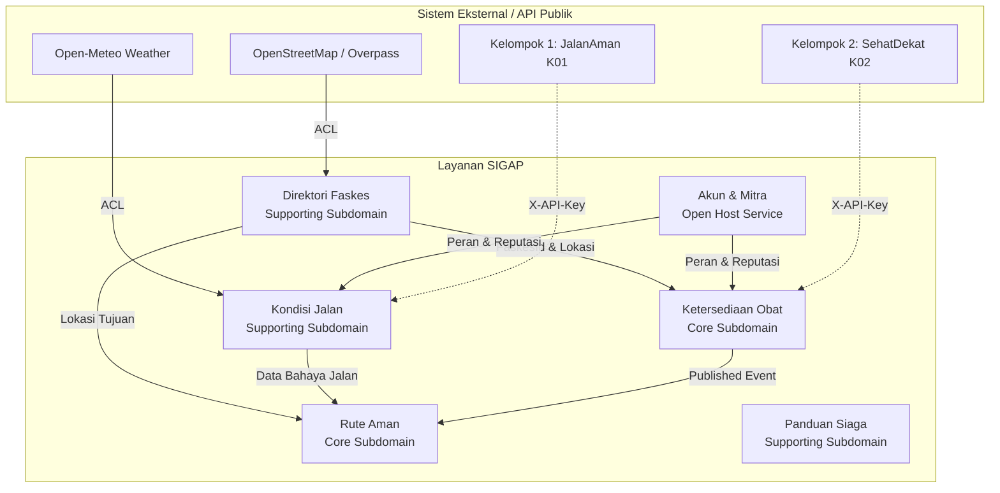

# SIGAP (Sehat, Informasi, Gerak, Akses, Pertolongan)

> **Web App & Mobile App untuk Pencarian Obat, Fasilitas Kesehatan, dan Rute Aman Bebas Banjir**  
> Tugas Besar Terintegrasi:
> - **II3160 Teknologi Sistem Terintegrasi (TST)** — Microservice di Set-Top Box (STB) & Integrasi Lintas Kelompok
> - **II3140 Pengembangan Aplikasi Web & Mobile (PWAM)** — Aplikasi Mobile React Native (Expo)
> 
> **Program Studi Sistem dan Teknologi Informasi**  
> **Sekolah Teknik Elektro dan Informatika (STEI)**  
> **Institut Teknologi Bandung (ITB) 2026**

---

## 👥 Tim Pengembang

| Nama | NIM | Peran Utama | Fokus Mata Kuliah |
| :--- | :--- | :--- | :--- |
| **Indah Ramadhani** | **18224037** | Backend & Bisnis | **II3160 TST** (DDD, Microservice, Docker di STB, Cloudflare Tunnel, Auth JWT/API Key) |
| **Belva Charissa P H** | **18224051** | Mobile Developer | **II3140 PWAM** (React Native Expo, Navigasi Stack & Tab, Form & Validasi, Integrasi API) |

---

## 📌 Ringkasan Produk & Pitch

**Pitch SIGAP:**  
> *"SIGAP menunjukkan faskes terdekat yang punya obatmu, rute yang aman dari hujan dan banjir, dan panduan singkat kapan cukup di rumah atau harus ke IGD."*

Aplikasi ini memadukan **tiga pilar utama**:
1. **Health & Wellbeing (Core):** Peta fasilitas kesehatan (apotek, klinik, puskesmas, RS) dan ketersediaan stok obat secara *realtime* berbasis laporan warga & mitra terverifikasi.
2. **Smart City & Mobility (Core):** Rekomendasi rute teraman menuju faskes dengan memperhitungkan cuaca ekstrem dan laporan bahaya jalan (banjir, longsor, jalan rusak) menggunakan algoritma penilai keamanan rute (skor 0–100).
3. **Education & Learning Tools (Supporting):** Kartu Siaga edukatif berbasis panduan resmi Kemenkes RI dan WHO untuk *triage* mandiri: kapan cukup dirawat di rumah, kapan ke puskesmas, dan kapan harus segera ke IGD.

---

## 🏛️ Arsitektur Domain-Driven Design (DDD)

Berdasarkan rancangan pada Makalah DDD dan PRD SIGAP, sistem dibagi menjadi 6 *Bounded Contexts*:



### 1. Ketersediaan Obat (Core Subdomain)
- **Aggregate Root:** `StokFaskes` (per pasangan faskes dan obat).
- **Invariants:**
  1. Laporan Mitra Terverifikasi mengalahkan laporan warga.
  2. Kesegaran laporan warga: `< 24 jam` (Segar), `24–72 jam` (Memudar), `> 72 jam` (Kedaluwarsa).
  3. Rate limit satu pengguna maksimal 1 laporan per obat per faskes per jam.
  4. Laporan yang bertentangan ditandai *"ada laporan berbeda"*, mengutamakan yang paling baru.

### 2. Rute Aman (Core Subdomain)
- **Aggregate Root:** `RencanaPerjalanan` (transient).
- **Invariants:**
  1. Menyediakan dua opsi rute: **Tercepat** (jalur arteri) vs **Teraman** (jalur dataran tinggi bebas banjir).
  2. Skor Aman (0–100) dikurangi untuk setiap titik bahaya jalan (banjir -35, longsor -45) dan cuaca ekstrem (-20).
  3. Bila semua rute berisiko tinggi (skor < 50), tampilkan peringatan darurat dan sarankan menelepon faskes terlebih dahulu.

### 3. Direktori Faskes (Supporting Subdomain)
- **Aggregate Root:** `Faskes` (Apotek, Klinik, Puskesmas, Rumah Sakit).
- **Invariants:** Koordinat wajib valid. Cek duplikasi entri (< 30 meter dengan nama mirip).

### 4. Kondisi Jalan (Supporting Subdomain)
- **Aggregate Root:** `BahayaJalan` (Banjir, Longsor, Jalan Rusak).
- **Invariants:** Bahaya aktif bila ada $\ge$ 2 konfirmasi warga atau 1 dari Mitra Terverifikasi. Kedaluwarsa otomatis dalam 3 jam jika tidak ada konfirmasi baru.

### 5. Panduan Siaga (Supporting Subdomain)
- **Aggregate Root:** `KartuSiaga`.
- **Invariants:** Setiap kartu wajib memiliki tingkat urgensi (`RUMAH`, `PUSKESMAS`, `IGD`), sumber rujukan resmi, tanggal tinjau, dan disclaimer medis. Bebas dari resep/diagnosis personal.

### 6. Akun dan Mitra (Generic Subdomain - Open Host Service)
- **Aggregate Root:** `Akun`, `KlaimFaskes`.
- **Invariants:** Satu faskes hanya boleh punya satu pemilik aktif. Reputasi pelapor naik saat laporan diverifikasi, dan turun jika ditandai palsu/salah.

---

## 🔌 Kontrak API & Autentikasi (OpenAPI 3.0)

Spesifikasi lengkap tersimpan di file [`openapi.yaml`](./openapi.yaml) dan koleksi Postman [`sigap-postman-collection.json`](./sigap-postman-collection.json).

### Mekanisme Autentikasi
1. **Pengguna Mobile App (Login):** JWT Token via header `Authorization: Bearer <token>` *(Mendapatkan Bonus Nilai TST +10%)*.
2. **Kelompok Lain (Server-to-Server):** Header `X-API-Key: SIGAP-PARTNER-ACCESS-KEY-2026`.
3. **Data Terbuka / Publik:** Dibatasi oleh *Rate Limiter* Nginx (15 req/s).

### Ringkasan Endpoint Utama

| Method | Endpoint | Autentikasi | Deskripsi |
| :--- | :--- | :--- | :--- |
| `GET` | `/api/health` | Publik | Health check microservice & konteks domain |
| `POST` | `/api/auth/login` | Publik | Login pengguna (menghasilkan JWT token) |
| `POST` | `/api/auth/register` | Publik | Registrasi Warga atau Mitra baru |
| `GET` | `/api/auth/me` | Bearer JWT | Informasi profil, peran, & reputasi pelapor |
| `GET` | `/api/faskes` | Publik | Daftar faskes, filter kategori, dan pencarian |
| `POST` | `/api/faskes` | Bearer JWT | Tambah faskes manual (cek duplikat < 30m) |
| `POST` | `/api/faskes/:id/klaim` | Bearer JWT | Pengajuan klaim faskes oleh Mitra |
| `GET` | `/api/obat` | Publik | Katalog obat acuan SIGAP |
| `GET` | `/api/stok` | Publik | Cek ketersediaan stok obat & skor kepercayaan |
| `POST` | `/api/stok/lapor` | Bearer JWT | Laporkan stok obat (dengan rate limit & invariant) |
| `GET` | `/api/kondisi-jalan/cuaca` | Publik | Snapshot cuaca live dari Open-Meteo + cache siaga |
| `GET` | `/api/kondisi-jalan/bahaya` | Publik | Daftar bahaya jalan aktif (banjir, longsor) |
| `POST` | `/api/kondisi-jalan/bahaya` | Bearer JWT | Lapor bahaya jalan |
| `POST` | `/api/kondisi-jalan/bahaya/:id/konfirmasi` | Bearer JWT | Konfirmasi laporan bahaya warga |
| `POST` | `/api/rute-aman/hitung` | Publik | Hitung opsi rute Tercepat vs Teraman (skor 0–100) |
| `GET` | `/api/kartu-siaga` | Publik | Kartu edukasi & triage rujukan Kemenkes/WHO |
| `GET` | `/api/public/faskes` | **X-API-Key** | Data faskes terbuka untuk kelompok lain |
| `GET` | `/api/public/stok-summary` | **X-API-Key** | Ringkasan stok obat untuk kelompok lain |
| `GET` | `/api/public/hazard-alerts` | **X-API-Key** | Peringatan titik banjir/longsor untuk kelompok Smart City |
| `GET` | `/api/peer/jalanaman` | Publik/App | Integrasi Kelompok 1: JalanAman (Smart City K01) |
| `GET` | `/api/peer/sehatdekat` | Publik/App | Integrasi Kelompok 2: SehatDekat (Health K02) |

---

## 🚀 Integrasi Lintas Kelompok (TST Tugas 3 & PWAM #3)

Aplikasi SIGAP mengonsumsi secara nyata API minimal 2 kelompok lain:
1. **Kelompok 1: JalanAman (Smart City & Titik Banjir - Kelas K01)**  
   - **Base URL:** `https://jalanaman.stei.fun/api`  
   - **Data yang dikonsumsi:** Titik banjir dan kemacetan warga di Bandung.  
   - **Penerapan di SIGAP:** Data titik banjir JalanAman digunakan oleh *PenilaiKeamananRute* untuk menurunkan skor rute dan memunculkan peringatan rute alternatif.
2. **Kelompok 2: SehatDekat (Health & Wellbeing - Kelas K02)**  
   - **Base URL:** `https://sehatdekat.stei.site/api`  
   - **Data yang dikonsumsi:** Antrean resep obat apotek dan kapasitas IGD puskesmas/RS.  
   - **Penerapan di SIGAP:** Ditampilkan pada kartu detail faskes untuk mengestimasi waktu tunggu sebelum pengguna berangkat.

> **🛡️ Ketahanan Terhadap Gangguan:**  
> Jika API kelompok lain *offline* atau *timeout* (> 3.5 detik), `ApiService.js` secara otomatis beralih ke *Fallback Cache Siaga*. Aplikasi dijamin **tidak akan pernah crash** saat API rekan kelas tidak aktif.

---

## 🛠️ Panduan Menjalankan Backend & STB Docker (TST)

### 1. Struktur Kontainer Docker (`docker-compose.yml`)
Sesuai aturan keamanan STB (agar perangkat tidak hang):
- `core-service`: Limit memori **256m**, CPU **0.5**, `restart: unless-stopped`.
- `gateway`: Nginx 1.28 alpine reverse proxy, limit memori **64m**, rate limiting 15 req/s.
- `tunnel`: Cloudflared tunnel client, limit memori **64m**, terhubung ke Cloudflare Zero Trust.

### 2. Menjalankan di Laptop / STB
1. Salin template `.env.example` menjadi `.env`:
   ```bash
   cp .env.example .env
   ```
2. Isi token Cloudflare Tunnel Anda pada `TUNNEL_TOKEN`:
   ```env
   PORT=3000
   JWT_SECRET=sigap-secret-jwt-key-tst-pwam-2026
   API_KEY=SIGAP-PARTNER-ACCESS-KEY-2026
   TUNNEL_TOKEN=eyJhIjoi...
   ```
3. Jalankan kontainer dengan Docker Compose:
   ```bash
   docker compose up -d
   ```
4. Cek status kontainer dan logs:
   ```bash
   docker compose ps
   docker compose logs core-service --tail=20
   ```
5. Uji health check lokal:
   ```bash
   curl http://localhost:8080/api/health
   ```

### 3. Setup Cloudflare Tunnel di one.dash.cloudflare.com
1. Login ke `one.dash.cloudflare.com` menggunakan akun kelas (`devi.willieam@itb.ac.id`).
2. Masuk ke menu **Networks** $\rightarrow$ **Tunnels** $\rightarrow$ **Create a tunnel**.
3. Pilih tipe **Cloudflared**, beri nama `k01-sigap` (atau `k02-sigap`).
4. Salin token tunnel ke file `.env` di STB (`TUNNEL_TOKEN`).
5. Pada tab **Public Hostname**, tambahkan:
   - **Subdomain:** `sigap`
   - **Domain:** `stei.fun` (K01) atau `stei.site` (K02)
   - **Type:** `HTTP`
   - **URL:** `gateway:80`
6. Uji akses publik dari browser/laptop:
   ```bash
   curl https://sigap.stei.fun/api/health
   ```

---

## 📱 Panduan Aplikasi Mobile React Native & Expo Go (PWAM)

Aplikasi dibangun menggunakan **React Native (Expo SDK 58)** dan dapat dijalankan langsung di HP menggunakan aplikasi **Expo Go** tanpa memerlukan instalasi Android Studio atau Xcode!

### 1. Menjalankan di Laptop untuk Expo Go
1. Pastikan dependensi sudah terinstal:
   ```bash
   npm install
   ```
2. Jalankan Expo development server:
   ```bash
   npx expo start
   ```
   *Atau jika laptop dan HP berada dalam jaringan WiFi berbeda, jalankan dengan tunnel:*
   ```bash
   npx expo start --tunnel
   ```
3. Buka aplikasi **Expo Go** di ponsel Anda:
   - **Android:** Buka aplikasi Expo Go $\rightarrow$ tap *"Scan QR code"* $\rightarrow$ scan barcode di terminal/browser laptop.
   - **iOS:** Buka aplikasi Camera bawaan $\rightarrow$ arahkan ke QR code $\rightarrow$ buka di Expo Go.

### 2. Fitur Layar Aplikasi (Kombinasi Stack + Tab Navigation)
1. **Layar Masuk (Login & Register):**
   - Validasi form (format email, panjang kata sandi $\ge$ 6 karakter).
   - Opsi pemilihan peran (Warga vs Mitra Faskes).
   - Akses instan *"1-Click Demo Login"* untuk dosen penguji (Warga Indah & Mitra Belva).
2. **Beranda (HomeScreen):**
   - Tombol 1-klik **Skenario Demo PRD: "Hujan Deras + Anak Demam"**.
   - Banner cuaca live terintegrasi Open-Meteo & deteksi genangan air aktif.
   - Ringkasan ketersediaan paracetamol sirup terdekat dengan status kesegaran data.
3. **Direktori Faskes & Stok (FaskesDirectoryScreen):**
   - Filter jenis faskes: Semua, Apotek, Klinik, Puskesmas, Rumah Sakit.
   - Pemilih obat interaktif: Paracetamol, Amoxicillin, Oralit, Cetirizine, Vitamin C.
   - Modal form tambah faskes manual dengan validasi duplikasi koordinat (< 30m).
4. **Detail Faskes (FaskesDetailScreen):**
   - Inventaris lengkap semua obat di faskes tsb.
   - Tombol telepon faskes & tombol cari rute aman langsung.
   - Fitur klaim kepemilikan faskes bagi Mitra.
5. **Rute Aman (SafeRouteScreen):**
   - Perbandingan berdampingan: **Rute Tercepat** vs **Rute Teraman**.
   - Skor Keamanan Rute (0–100) dan daftar titik banjir/longsor di sepanjang jalan.
   - Form lapor bahaya jalan warga dan tombol konfirmasi lapangan.
6. **Kartu Siaga Kesehatan (KartuSiagaScreen & KartuDetailScreen):**
   - Filter tingkat urgensi: `Semua`, `🏠 Mandiri Rumah`, `🏥 Puskesmas`, `🚨 Gawat Darurat (IGD)`.
   - Pencarian berdasarkan keluhan (misal *"demam anak"*, *"diare"*, *"DBD"*).
   - Penjelasan tanda bahaya (*red flags*), tindakan awal, rujukan Kemenkes/WHO, dan disclaimer medis.
7. **Profil & Hub Integrasi API (ProfileScreen):**
   - Pengubah peran demo (Warga $\leftrightarrow$ Mitra $\leftrightarrow$ Admin).
   - Dasbor persetujuan klaim faskes bagi Admin.
   - Pengecek kesehatan server dan pengujian langsung API Kelompok Lain (JalanAman & SehatDekat).

---

## 🧪 Pengujian & Verifikasi (Testing)

### 1. Menjalankan Unit Test (Domain-Driven Invariants)
Jalankan perintah pengujian dari root:
```bash
npm test
```

### 2. Matriks Hasil Uji Invariant (7/7 Passed)

| ID Uji | Target Invariant DDD / PRD | Kriteria Penerimaan | Status |
| :--- | :--- | :--- | :---: |
| **TC-01** | **FR-KO-04** (Prioritas Mitra) | Laporan Mitra mengalahkan laporan warga meskipun warga lebih baru | **PASS (100%)** |
| **TC-02** | **FR-KO-05** (Kesegaran Warga) | `<24 jam` = Segar, `24-72 jam` = Memudar, `>72 jam` = Kedaluwarsa | **PASS (100%)** |
| **TC-03** | **FR-KO-06** (Rate Limit Laporan) | Maksimal 1 laporan per obat per faskes per user per jam | **PASS (100%)** |
| **TC-04** | **FR-KO-07** (Laporan Konflik) | Muncul tanda peringatan *"ada laporan berbeda"* saat ada kontradiksi | **PASS (100%)** |
| **TC-05** | **FR-RA-01 s/d 06** (Rute Aman) | Skor rute teraman $\ge$ rute cepat yang melewati titik banjir; banner peringatan aktif | **PASS (100%)** |
| **TC-06** | **FR-PS-01 s/d 05** (Kartu Siaga) | Filter keluhan akurat, wajib ada disclaimer, tanggal tinjau, dan rujukan | **PASS (100%)** |
| **TC-07** | **FR-AM-01** (Autentikasi JWT) | Generasi token valid, enkripsi tanda tangan rahasia, verifikasi profil pengguna | **PASS (100%)** |

---

## 📦 Build APK Android (Deliverable PWAM #6)

File konfigurasi build EAS Android telah disiapkan di [`eas.json`](./eas.json).

Untuk melakukan build file `Aplikasi_Release.apk` di cloud EAS:
1. Pastikan sudah login ke akun Expo:
   ```bash
   npx eas login
   ```
2. Jalankan perintah build APK:
   ```bash
   npx eas build -p android --profile preview
   ```
3. Unduh file `.apk` hasil build dari dashboard EAS dan salin ke direktori rilis:
   ```bash
   Aplikasi_Release.apk
   ```

---

## 📂 Struktur Direktori Proyek

```text
sigap-coffee-app/
├── backend/                         # [TST] Microservice Core & Docker
│   ├── src/
│   │   ├── data/seedData.js         # Data faskes Bandung, obat, cuaca, & kartu siaga
│   │   ├── domain/                  # Logika Domain Invariant Murni (DDD)
│   │   │   ├── PenghitungStatusStok.js
│   │   │   ├── PenilaiKeamananRute.js
│   │   │   └── PemilihKartu.js
│   │   ├── middleware/auth.js       # JWT & X-API-Key Verification
│   │   ├── routes/api.routes.js     # REST API Router
│   │   └── server.js                # Express App Server
│   ├── test/
│   │   └── domain.test.js           # Unit test invariant DDD
│   ├── Dockerfile                   # Multi-arch lightweight runner (< 256MB)
│   ├── docker-compose.yml           # Compose backend mandiri
│   ├── nginx.conf                   # Reverse proxy gateway & rate limiter
│   └── package.json
│
├── src/                             # [PWAM] Aplikasi Mobile React Native (Expo)
│   ├── components/                  # Komponen UI (Badge, Card, Modal, Tag)
│   │   ├── Badge.js
│   │   ├── FaskesCard.js
│   │   ├── FreshnessTag.js
│   │   ├── KartuSiagaCard.js
│   │   ├── ModalLaporBahaya.js
│   │   ├── ModalLaporStok.js
│   │   └── ModalTambahFaskes.js
│   ├── contexts/                    # Modular Monolith DDD Contexts
│   │   ├── akun-mitra/
│   │   ├── direktori-faskes/
│   │   ├── ketersediaan-obat/
│   │   ├── kondisi-jalan/
│   │   ├── panduan-siaga/
│   │   └── rute-aman/
│   ├── navigation/
│   │   └── AppNavigator.js          # Kombinasi Stack & Tab Navigation
│   ├── screens/                     # 7 Layar Aplikasi Lengkap
│   │   ├── LoginScreen.js           # Layar Masuk dengan Validasi Form
│   │   ├── RegisterScreen.js        # Layar Daftar Baru
│   │   ├── HomeScreen.js            # Beranda & Skenario Demo Instan
│   │   ├── FaskesDirectoryScreen.js # Direktori Faskes & Stok Obat
│   │   ├── FaskesDetailScreen.js    # Detail Faskes & Inventaris
│   │   ├── SafeRouteScreen.js       # Hitung Rute Tercepat vs Teraman
│   │   ├── KartuSiagaScreen.js      # Kartu Edukasi & Triage Medis
│   │   ├── KartuDetailScreen.js     # Detail Lengkap Kartu Siaga
│   │   └── ProfileScreen.js         # Profil, Hak Akses, & Uji Integrasi Peer
│   ├── services/
│   │   └── ApiService.js            # Konsumsi API Backend & Integrasi 2 Kelompok
│   ├── shared/EventBus.js           # Realtime in-app pub/sub event bus
│   └── theme/colors.js              # Desain palet hijau elegan (Health & Wellbeing)
│
├── openapi.yaml                     # Spesifikasi Kontrak API OpenAPI 3.0
├── sigap-postman-collection.json    # Koleksi Postman siap impor
├── docker-compose.yml               # Docker Compose root untuk STB
├── eas.json                         # Konfigurasi build Android APK
├── app.json                         # Konfigurasi Expo & ikon aplikasi
├── package.json                     # Root scripts & dependensi
└── README.md                        # Dokumentasi komprehensif proyek
```

---

## 📅 Timeline & Checklist Pengumpulan (Minggu 12–16)

- [x] **Minggu 12:** Pemilihan kelompok, tema *Health & Wellbeing + Smart City + Education*, dan model DDD.
- [x] **Minggu 13:** Pengumpulan Makalah DDD (*Tugas 1 TST*).
- [x] **Minggu 14:** Registrasi Nama Kelompok `sigap` di API Registry Kelas & Publikasi Kontrak OpenAPI.
- [x] **Minggu 15:** Implementasi Microservice di STB, Integrasi API $\ge 2$ Kelompok Lain (*JalanAman & SehatDekat*), dan Aplikasi Mobile PWAM.
- [x] **Minggu 16 (13 Des 2026):** Pengujian *End-to-End*, build `Aplikasi_Release.apk`, dan rekaman video YouTube demo sistem.
